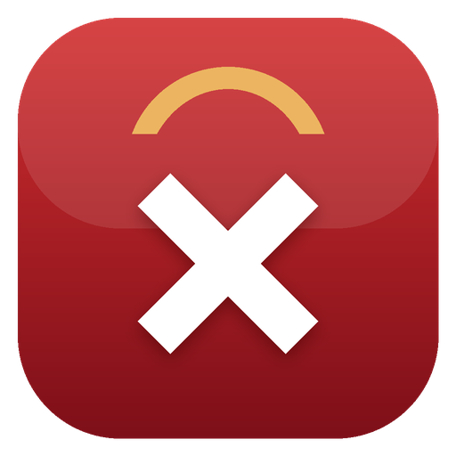

<p align="center">
  
</p>

<h1 align="center">SpartanX</h1>

<p align="center">
  <b>Dynamic Island, Dock e barra dei menu fluidi per Windows 11.</b><br/>
  Animazioni a molla, Assistente configurazione stile macOS e Impostazioni stile Impostazioni di Sistema.
</p>

<p align="center"><a href="README.md">🇬🇧 Read in English</a></p>

---

> **Stato: anteprima (0.1).** Le funzioni principali sono operative; possibili imperfezioni. Feedback e PR sono benvenuti.

## ✨ Funzionalità

### Dynamic Island
- **Pillola nera sotto il bordo superiore** che si trasforma tra *compatta*, *anteprima* (hover) ed *espansa* (clic) con vera fisica a molla.
- **In riproduzione** da qualsiasi app nei controlli multimediali di Windows (Spotify, browser, Apple Music, VLC…): copertina, titolo, artista, avanzamento, controlli e **indicatore audio reale**.
- **Attività di sistema**: volume, caricatore collegato/scollegato, batteria scarica, rete connessa/persa.
- **Timer** con preset rapidi (1/5/10/25 min), pausa e annulla.
- **Meteo** della tua città (Open-Meteo, senza account né chiave API).
- **Notifiche** *(richiede il futuro pacchetto firmato — vedi [Roadmap](docs/ROADMAP.md))*.

### Dock
- **Ingrandimento stile macOS** con decadimento morbido e molle per ogni icona.
- **Rimbalzo all'avvio**, indicatori app aperte, clic sull'app attiva per ridurla.
- **App fissate + app in esecuzione**; le app fissate sulla barra di Windows vengono importate al primo avvio.
- **Pile di cartelle** (Download predefinita) a griglia, **Cestino**.
- **Nascondi automaticamente**, posizione in basso / sinistra / destra, trascina app o cartelle per fissarle.
- Menu contestuali: elenco finestre, Mantieni nel Dock, Mostra in Esplora file, Chiudi.
- **Sostituisce la barra delle applicazioni** (opzionale) — sempre ripristinata all'uscita, anche dopo un crash.

### Barra dei menu
- Menu SpartanX (Impostazioni, Start, Gestione attività, Sospendi, Riavvia, Spegni, Blocca).
- Nome dell'app attiva, Wi-Fi/Ethernet, volume, batteria, centro notifiche, orologio con calendario.

### Assistente e Impostazioni
- Al primo avvio **"hello" in tante lingue**, poi Lingua → Aspetto → Dock → Isola → Privacy, con anteprime dal vivo.
- **Finestra stile Impostazioni di Sistema** con barra laterale a icone colorate e ricerca.
- Chiaro / Scuro / Automatico, accento **rosso spartano** (o accento di Windows, preset, hex personalizzato), Mica / Acrilico / Mica Alt.
- **Controllo animazioni**: Fluido / Scattante / Elastico / Molla personalizzata, velocità, Riduci movimento.
- **Scorciatoie globali** registrabili: `Ctrl+Alt+D`, `Ctrl+Alt+I`, `Ctrl+Alt+,`, `Ctrl+Alt+Space`, `Ctrl+Alt+T`.
- Interfaccia **italiana e inglese**, **aggiornamenti in-app** da GitHub Releases.

## 📦 Installazione

1. Scarica `SpartanX-<versione>-win-x64.zip` (o `win-arm64`) da [Releases](https://github.com/xX-VyrnCore-Xx/SpartanX/releases).
2. Estrai in una cartella tua, es. `%LOCALAPPDATA%\Programs\SpartanX`.
3. Avvia `SpartanX.exe`: parte l'Assistente configurazione.

**Requisiti:** Windows 11 22H2 o successivo, x64 o ARM64. Nessun runtime aggiuntivo.

> ⚠️ Lo ZIP non è ancora firmato: SmartScreen potrebbe avvisarti (*Ulteriori informazioni → Esegui comunque*). Verifica il file `.sha256` pubblicato accanto allo ZIP.

## 🛠️ Compilare dal sorgente

Requisiti: Windows 11, [.NET 10 SDK](https://dotnet.microsoft.com/download), opzionalmente Visual Studio 2026 con il carico di lavoro *Sviluppo di applicazioni WinUI*.

```bash
dotnet test tests/SpartanX.Core.Tests
```

```bash
dotnet run --project src/SpartanX.App -p:Platform=x64 -r win-x64
```

Dettagli tecnici in [docs/ARCHITECTURE.md](docs/ARCHITECTURE.md).

## 🔒 Privacy

Nessuna telemetria, nessun account. La rete serve solo a controllare gli aggiornamenti su GitHub (disattivabile) e, se attivi il meteo, a inviare il **nome della città** a Open-Meteo.

## ❓ FAQ

**La barra delle applicazioni è sparita e SpartanX è chiuso.** Avvia SpartanX e chiudilo dal suo menu, oppure disattiva *Sostituisci la barra delle applicazioni* in Impostazioni → Generali.

## 🤝 Contribuire

Leggi [CONTRIBUTING.md](CONTRIBUTING.md). Licenza [MIT](LICENSE).

SpartanX è un progetto indipendente, non affiliato ad Apple o Microsoft.
