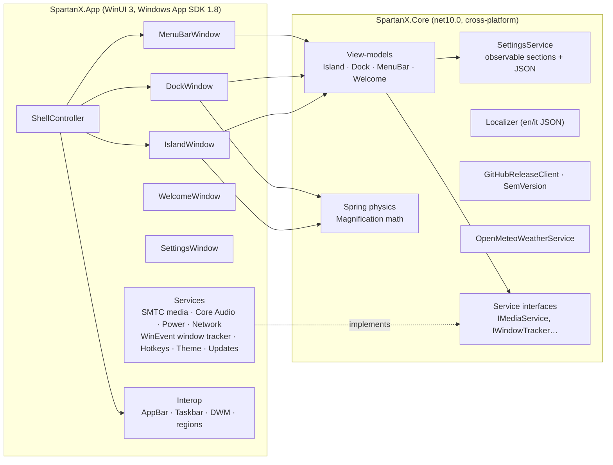
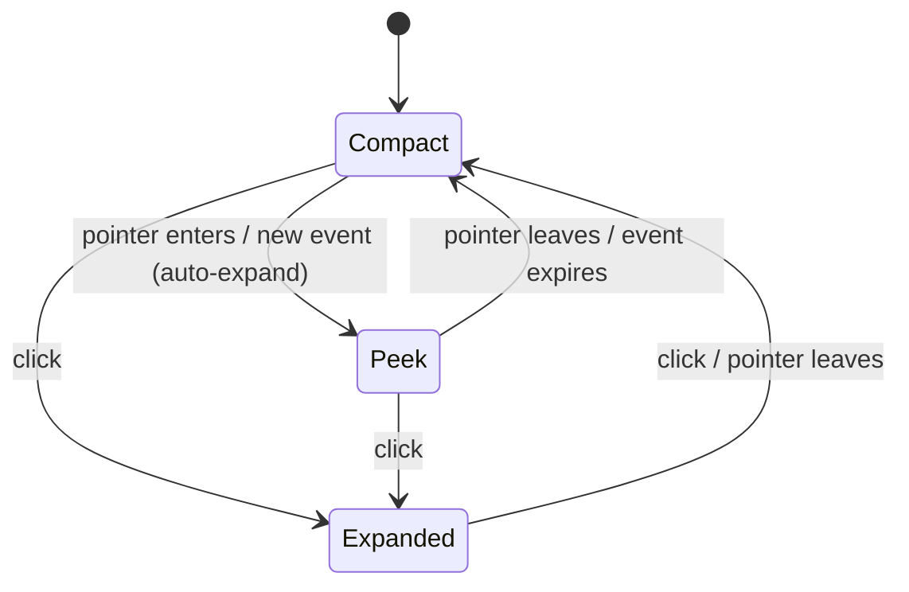

# Architecture

SpartanX is split into a **platform-independent core** and a **thin WinUI 3 shell**. Everything that can be
unit-tested without Windows lives in `SpartanX.Core`.

## Shell surfaces

| Window | Size | Hit-testing | Notes |
|---|---|---|---|
| **Menu bar** | full width × 34 DIP, top | whole window | Registered as an `ABE_TOP` AppBar so maximised windows start below it. Acrylic/Mica backdrop. |
| **Dynamic Island** | 456 × 216 DIP, top-centre | window **region** that hugs the pill | Transparent (`TransparentTintBackdrop`). The region grows *before* the pill animates so nothing is clipped, and shrinks when the spring settles. |
| **Dock** | full width (or height) strip at the chosen edge | region = bar; full strip while hovered; 2 px strip when auto-hidden | Registered as an AppBar unless auto-hide is on. Hover state is zone-based so the transparent area above the Dock never blocks clicks. |

All three are borderless tool windows (`WS_EX_TOOLWINDOW`, hidden from Alt+Tab), always on top. The Island and Dock
also use `WS_EX_NOACTIVATE` so clicking them never steals focus from the app you are using.

## Animation model

- **`Spring`** (Core) is a frame-rate-independent damped spring integrated with fixed sub-steps. Parameters use
  SwiftUI's vocabulary: *response* (period, seconds) and *damping fraction* (1 = no overshoot). Retargeting keeps
  velocity, so interrupting an animation feels continuous.
- **`FrameTicker`** hooks `CompositionTarget.Rendering` only while something animates, so an idle shell costs ~0% CPU.
- Size-changing animations (Island morph, Dock magnification) run springs on the UI thread and set layout sizes each
  frame. Opacity / translation effects use **Composition** animations (`Motion`) that run on the compositor thread.
- The user's *Animations* settings (profile, custom spring, speed, Reduce Motion) are applied through `Motion.Spring()`.

## Dynamic Island state machine

`IslandActivityManager` keeps one activity per kind; the highest priority wins
(`TimerFinished > Notification > Volume > Battery > Network > Timer > Media > Weather > Idle`).
Transient activities carry an expiry and re-posting one extends it. `IslandLayout` maps *(mode, activity)* to a
target size; the window springs toward it and cross-fades the matching content panel.

## Dock

`DockViewModel` merges pinned apps (`.exe`, `.lnk` resolved to their target, or shell URIs) with running windows
grouped by executable, preserving view-model instances so icons and animations survive rebuilds.
`MagnificationCalculator` computes per-icon scale from the pointer position using **rest-layout centres** (stable
while the row grows) and a cosine falloff over three icon widths.

## Settings & persistence

`AppSettings` is a tree of `ObservableObject` sections bound two-way from the UI, so every window updates live.
`SettingsService` debounces writes (400 ms) and writes atomically (temp file + rename). A corrupt file is preserved
as `settings.json.corrupt` and defaults are used.

## Taskbar replacement safety

`TaskbarController` stores the original auto-hide state in `%LOCALAPPDATA%\SpartanX\taskbar-state.json` before
touching anything. It is restored on quit, on unhandled exceptions, on process exit, and on the next launch if the
feature is disabled. A 2-second enforcer re-hides the taskbar if Explorer brings it back.

## Packaging & updates

The app is **unpackaged and self-contained** (`WindowsPackageType=None`, `WindowsAppSDKSelfContained=true`): the
release ZIP runs without installing the Windows App Runtime. `UpdateService` checks GitHub Releases, downloads the
architecture-specific ZIP and hands over to a small PowerShell script that waits for exit, extracts in place and
restarts.

## Threading

Windows services raise events on background threads. View-models marshal onto the UI thread through
`IUiDispatcher` (a `DispatcherQueue` in the app, inline in tests). WinEvent hooks are out-of-context and delivered on
the UI thread's message loop, then debounced.
